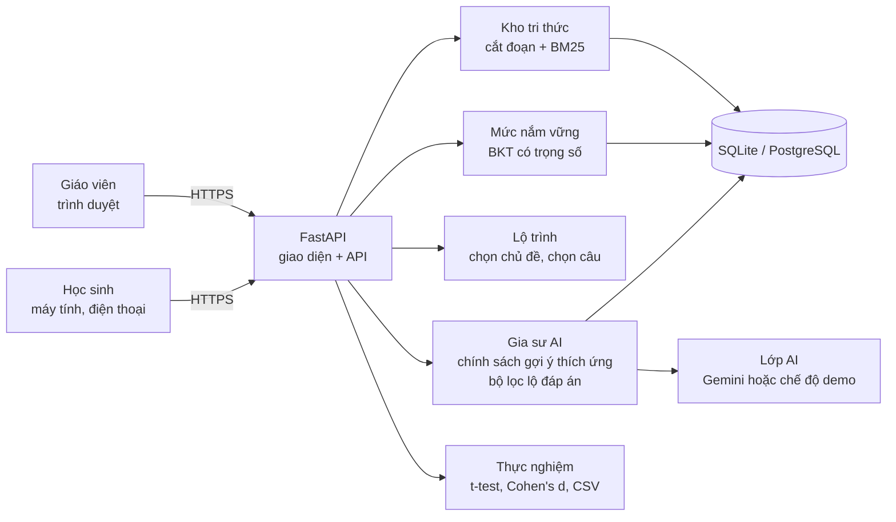
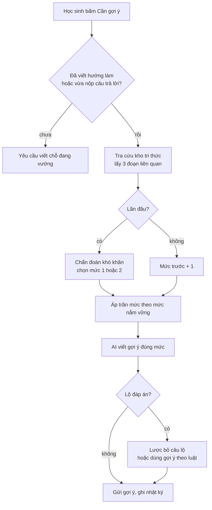

# Thiết kế hệ thống AI Gợi Mở

Tài liệu mô tả kiến trúc, mô hình dữ liệu, các thuật toán và thiết kế thực nghiệm của hệ thống, dùng làm cơ sở cho phần "Thiết kế và phương pháp" của báo cáo đề tài.

## 1. Kiến trúc



- Ngôn ngữ: Python 3.10+. Web: FastAPI, Jinja2, Bootstrap 5 (đóng gói sẵn, chạy được không cần Internet).
- CSDL: SQLAlchemy 2, mặc định SQLite (một tệp `data/app.db`), có thể dùng PostgreSQL.
- AI: Google Gemini qua thư viện `google-genai`, đầu ra JSON theo lược đồ. Khi chưa có khóa API, hệ thống chạy chế độ demo: gợi ý dựng theo luật từ lời giải mẫu và tài liệu đã duyệt.

## 2. Mô hình dữ liệu

| Bảng | Ý nghĩa | Trường chính |
|---|---|---|
| teachers | Giáo viên | email, mật khẩu (băm scrypt) |
| courses | Môn học / khóa học | tên, khối, chính sách gợi ý (JSON) |
| topics | Chủ đề trong lộ trình | thứ tự, danh sách chủ đề tiên quyết |
| materials | Tài liệu học tập | nội dung, trạng thái (chờ duyệt / đã duyệt) |
| chunks | Đoạn tri thức của tài liệu đã duyệt | văn bản, chủ đề |
| questions | Câu hỏi | loại (trắc nghiệm, trả lời ngắn, tự luận ngắn), đáp án chấp nhận, lời giải từng bước, mức độ, mục đích (luyện tập / kiểm tra), trạng thái (nháp / đã duyệt / ẩn) |
| exams, exam_attempts | Bài kiểm tra không có AI và bài làm | loại (đầu vào, sau học, ghi nhớ), điểm thang 10 |
| classrooms, students | Lớp, học sinh | chế độ mặc định của lớp, chế độ riêng của học sinh, mã đăng nhập |
| masteries | Mức nắm vững theo chủ đề | p (xác suất đã nắm vững), số bằng chứng |
| practice_sessions | Một lần luyện một câu | chế độ, số lần trả lời, số lần nhờ AI, mức hỗ trợ cao nhất, đã xem lời giải, tự lực, p trước/sau |
| messages | Nhật ký tương tác | vai trò, loại, mức gợi ý, nội dung, chẩn đoán của AI, nguồn tài liệu, cờ chặn lộ đáp án |

## 3. Kho tri thức do giáo viên kiểm duyệt

1. Giáo viên tải tệp (.docx, .pdf, .txt, .md) hoặc dán văn bản. Hệ thống trích văn bản, giáo viên đọc lại, sửa rồi bấm Duyệt.
2. Tài liệu đã duyệt được cắt thành các đoạn khoảng 700 ký tự, ưu tiên ranh giới đoạn văn rồi đến câu.
3. Khi cần gợi ý, hệ thống tra cứu 3 đoạn liên quan nhất bằng BM25 trên âm tiết tiếng Việt đã bỏ dấu và các cặp âm tiết liền nhau (k1 = 1,5; b = 0,75). Đoạn thuộc đúng chủ đề của câu hỏi được nhân hệ số 1,6.
4. AI chỉ được dùng các đoạn này; mỗi gợi ý ghi lại nguồn tài liệu đã dùng. Tài liệu bị gỡ duyệt được xóa khỏi chỉ mục ngay.

## 4. Mức nắm vững: Bayesian Knowledge Tracing có trọng số

Mỗi học sinh có xác suất p đã nắm vững từng chủ đề (khởi tạo 0,3). Với bằng chứng đúng hoặc sai:

```
P(L | đúng) = p(1 − s) / [p(1 − s) + (1 − p)·g]
P(L | sai)  = p·s / [p·s + (1 − p)(1 − g)]
```

s = 0,10 (nắm vững nhưng sơ suất); g = 0,25 với trắc nghiệm, 0,08 với trả lời ngắn, 0,10 với tự luận ngắn.

Một câu làm đúng nhờ nhiều gợi ý không chứng minh học sinh đã nắm vững, nên mỗi phiên luyện tập có điểm tín nhiệm c:

- Đúng ngay, không gợi ý: c = 1
- Mỗi lần trả lời sai trước đó: −0,2 (trắc nghiệm −0,3)
- Gợi ý mức 1: −0,05; từ mức 2: thêm −0,2 cho mỗi mức
- Xem lời giải hoặc bỏ qua: c = 0

```
p_hậu nghiệm = c·P(L | đúng) + (1 − c)·P(L | sai)
p_mới = p_hậu nghiệm + (1 − p_hậu nghiệm)·T,  T = 0,12
```

Câu trong bài kiểm tra là bằng chứng với c = 1 hoặc 0 và không cộng T (không học được trong lúc kiểm tra). Ngưỡng: từ 0,85 là thành thạo; từ 0,7 bắt đầu giảm hỗ trợ; dưới 0,4 là cần củng cố.

## 5. Lộ trình cá nhân hóa

- Bài đầu vào khởi tạo mức nắm vững mọi chủ đề. Khi bài đầu vào đang mở, học sinh phải làm xong mới được luyện tập.
- Chủ đề được đề xuất: chủ đề đầu tiên theo thứ tự chưa thành thạo và đã đạt các chủ đề tiên quyết (p ≥ 0,6).
- Chọn câu luyện tập: độ khó mục tiêu theo p (dưới 0,35 → Nhận biết; dưới 0,6 → Thông hiểu; dưới 0,8 → Vận dụng; còn lại → Vận dụng cao). Câu đã tự giải trong 72 giờ bị hạ ưu tiên; câu từng phải nhờ nhiều gợi ý được đưa trở lại sau ít nhất 12 giờ (ôn lại giãn cách).

## 6. Cơ chế hỗ trợ thích ứng (nhóm thực nghiệm)

### 6.1. Bậc thang gợi ý

| Mức | Tên | Nội dung | Ràng buộc |
|---|---|---|---|
| 1 | Định hướng | 1–2 câu hỏi gợi mở: đề hỏi gì, đã biết gì | Không nêu công thức, cách làm |
| 2 | Gợi nhắc kiến thức | Khái niệm, quy tắc lấy từ tài liệu đã duyệt | Không áp dụng hộ vào bài |
| 3 | Gợi ý cách làm | Hướng giải hoặc bước đầu tiên | Không thực hiện các bước |
| 4 | Làm mẫu một phần | Các bước trung gian hoặc ví dụ tương tự | Dừng trước bước cuối |
| 5 | Lời giải chi tiết | Lời giải đầy đủ kèm lời khuyên tự làm lại | Chỉ mở khi đủ điều kiện |

### 6.2. Quy tắc

1. Thử trước khi hỏi: trước gợi ý đầu tiên, và sau mỗi gợi ý nếu chưa nộp thêm câu trả lời, học sinh phải viết hướng làm hoặc chỗ đang vướng (ít nhất 15 ký tự).
2. Mức đầu tiên: AI (hoặc luật ở chế độ demo) chẩn đoán loại khó khăn: chưa hiểu đề, chưa biết bắt đầu, thiếu kiến thức, sai hướng, sai sót nhỏ. Học sinh còn yếu (p < 0,4) và thiếu kiến thức hoặc chưa biết bắt đầu được nhắc kiến thức ngay (mức 2); sai sót nhỏ và các trường hợp còn lại bắt đầu ở mức 1.
3. Mỗi lần nhờ tiếp, mức tăng đúng 1.
4. Giảm dần hỗ trợ: khi p ≥ 0,7 và học sinh chưa trả lời sai đủ 2 lần, mức tối đa là 3 (giáo viên chỉnh được).
5. Lời giải chi tiết (mức 5) chỉ mở khi học sinh đã trả lời sai ít nhất 2 lần và đã nhận gợi ý mức 4.
6. Câu hỏi tự do của học sinh được trả lời theo cùng nguyên tắc: giải thích khái niệm từ tài liệu, từ chối nhẹ nhàng khi học sinh xin đáp án.
7. Bộ lọc lộ đáp án: mọi gợi ý mức 1–4 và câu trả lời tự do được so với đáp án. Đáp án dạng số hoặc một từ chỉ bị coi là lộ khi được nêu như kết quả ("kết quả là 14", "đáp án: False"); đáp án dạng mã lệnh hay biểu thức bị coi là lộ khi xuất hiện nguyên văn. Câu bị lộ được lược bỏ; nếu phần còn lại quá ngắn thì thay bằng gợi ý theo luật, hoặc lùi về câu hỏi định hướng. Mỗi lần chặn được ghi vào nhật ký.



### 6.3. Định nghĩa "tự lực"

Một câu luyện tập được tính là tự giải (tự lực) khi học sinh trả lời đúng, không xem lời giải và chỉ cần tối đa gợi ý mức 1 (câu hỏi định hướng, không chứa kiến thức hay cách làm).

## 7. Chế độ đối chứng: AI giải trực tiếp

Mô phỏng cách học sinh thường dùng chatbot: bấm "Hỏi AI lời giải" là nhận ngay lời giải đầy đủ kèm đáp án; câu hỏi tự do được trả lời trực tiếp. Lời giải được ghi mức hỗ trợ 5, câu trả lời không nêu đáp án được ghi mức 3. Hai nhóm dùng cùng ngân hàng câu hỏi, cùng kho tri thức, cùng giao diện; chỉ khác chính sách hỗ trợ của AI.

## 8. Thiết kế thực nghiệm

### 8.1. Quy trình đề xuất

1. Chuẩn bị: môn học, chủ đề, tài liệu đã duyệt; câu luyện tập (có lời giải từng bước) và câu kiểm tra tách riêng.
2. Tuần 0: bài đầu vào (không AI). Chia nhóm ngẫu nhiên cân bằng theo điểm đầu vào: xếp theo điểm, ghép cặp liền kề, bốc thăm trong mỗi cặp. Có thể chọn so sánh theo lớp (một lớp thực nghiệm, một lớp đối chứng).
3. Tuần 1–3 (hoặc lâu hơn): học sinh luyện tập trên hệ thống theo nhóm của mình.
4. Cuối đợt: bài kiểm tra ngay sau học (không AI).
5. Sau 1–2 tuần không luyện chủ đề đó: bài kiểm tra ghi nhớ, cùng bộ câu hoặc bộ câu tương đương.

### 8.2. Chỉ số

| Mục tiêu đề tài | Chỉ số trong hệ thống |
|---|---|
| Khả năng ghi nhớ | Điểm bài ghi nhớ; mức giảm từ bài sau học đến bài ghi nhớ |
| Giải bài tập độc lập | Điểm bài sau học (không AI); tỉ lệ câu luyện tập tự giải |
| Mức độ cần hỗ trợ từ AI | Mức hỗ trợ cao nhất trung bình mỗi câu (0–5); số lần nhờ AI; tỉ lệ xem lời giải; xu hướng theo tuần |
| Tương đương ban đầu | Điểm bài đầu vào của hai nhóm |
| Hiệu quả học tập | Mức tiến bộ = điểm sau học − điểm đầu vào |

### 8.3. Thống kê

- Trung bình, độ lệch chuẩn từng nhóm.
- Kiểm định t hai mẫu độc lập, không giả định phương sai bằng nhau (Welch); giá trị p hai phía tính bằng hàm beta không đầy đủ.
- Hệ số ảnh hưởng Cohen's d với độ lệch chuẩn gộp; thang diễn giải 0,2 / 0,5 / 0,8.
- Xuất CSV (theo học sinh, theo phiên, nhật ký tương tác) để phân tích sâu hơn bằng Excel, SPSS hoặc R, ví dụ ANCOVA với điểm đầu vào làm hiệp biến, hoặc phân tích định tính nội dung gợi ý.

### 8.4. Giá trị và độ tin cậy

- Câu kiểm tra tách khỏi câu luyện tập để tránh đo lại đúng nội dung đã được AI giải.
- Bài kiểm tra có giới hạn thời gian, mỗi học sinh làm một lần; danh sách câu bị khóa khi đã có học sinh nộp.
- Nên cố định tên mô hình Gemini trong suốt đợt thực nghiệm (GEMINI_MODEL) để kết quả nhất quán.
- Dữ liệu mẫu (is_demo) được đánh dấu riêng và trang báo cáo cảnh báo khi có dữ liệu mẫu.

## 9. Bảo mật, quyền riêng tư, đạo đức nghiên cứu

- Mật khẩu băm scrypt; phiên đăng nhập ký bằng khóa bí mật; mọi form có mã CSRF; giáo viên chỉ thấy dữ liệu lớp của mình.
- Học sinh đăng nhập bằng mã 6 ký tự, không cần email hay số điện thoại.
- Khi gọi AI, hệ thống gửi đề bài, đáp án tham khảo, câu trả lời và đoạn tài liệu; không gửi họ tên học sinh.
- Học sinh phần lớn chưa đủ 18 tuổi: cần thông báo và có văn bản đồng ý của phụ huynh trước khi thu thập dữ liệu, theo quy định về bảo vệ dữ liệu cá nhân.
- Theo điều khoản của Google, dữ liệu gửi qua gói Gemini miễn phí có thể được dùng để cải thiện sản phẩm; với dữ liệu thật nên dùng gói trả phí hoặc chạy chế độ demo.

## 10. Giới hạn hiện tại

- Chấm câu trả lời ngắn: so khớp sau chuẩn hóa và so sánh số; với Gemini có thêm bước AI xét câu trả lời tương đương. Câu tự luận dài chưa được hỗ trợ đầy đủ.
- Chẩn đoán khó khăn ở chế độ demo dựa trên từ khóa và so sánh số, độ chính xác thấp hơn khi dùng Gemini.
- Tham số BKT đặt theo kinh nghiệm; có thể ước lượng lại từ dữ liệu thực nghiệm.
